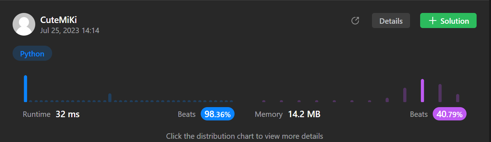

# 1. Two Sum
### Tag: [Easy](https://github.com/TheOnlyMiki/LeetCode-For-Fun/tree/main#easy-level), [Array](https://github.com/TheOnlyMiki/LeetCode-For-Fun/tree/main#array), [Hash Table](https://github.com/TheOnlyMiki/LeetCode-For-Fun/tree/main#hash-table)
---
<div class="px-5 pt-4"><div class="flex"></div><div class="_1l1MA" data-track-load="description_content"><p>Given an array of integers <code>nums</code>&nbsp;and an integer <code>target</code>, return <em>indices of the two numbers such that they add up to <code>target</code></em>.</p>

<p>You may assume that each input would have <strong><em>exactly</em> one solution</strong>, and you may not use the <em>same</em> element twice.</p>

<p>You can return the answer in any order.</p>

<p>&nbsp;</p>
<p><strong class="example">Example 1:</strong></p>

<pre><strong>Input:</strong> nums = [2,7,11,15], target = 9
<strong>Output:</strong> [0,1]
<strong>Explanation:</strong> Because nums[0] + nums[1] == 9, we return [0, 1].
</pre>

<p><strong class="example">Example 2:</strong></p>

<pre><strong>Input:</strong> nums = [3,2,4], target = 6
<strong>Output:</strong> [1,2]
</pre>

<p><strong class="example">Example 3:</strong></p>

<pre><strong>Input:</strong> nums = [3,3], target = 6
<strong>Output:</strong> [0,1]
</pre>

<p>&nbsp;</p>
<p><strong>Constraints:</strong></p>

<ul>
	<li><code>2 &lt;= nums.length &lt;= 10<sup>4</sup></code></li>
	<li><code>-10<sup>9</sup> &lt;= nums[i] &lt;= 10<sup>9</sup></code></li>
	<li><code>-10<sup>9</sup> &lt;= target &lt;= 10<sup>9</sup></code></li>
	<li><strong>Only one valid answer exists.</strong></li>
</ul>

<p>&nbsp;</p>
<strong>Follow-up:&nbsp;</strong>Can you come up with an algorithm that is less than&nbsp;<code>O(n<sup>2</sup>)&nbsp;</code>time complexity?</div></div>

---


### Solution

```python
class Solution:
    def twoSum(self, nums: List[int], target: int) -> List[int]:

        if len(nums) < 2:
            return False
        '''
        pair = {}
        for i in range(len(nums)):
            diff = target - nums[i]
            if diff in pair:
                return [pair[diff], i]
            pair[nums[i]] = i

        return False
        '''

        remain = {}
        for i, num in enumerate(nums):
            if target - num in remain:
                remain = [remain[target - num], i]
                break
            remain[num] = i

        return remain
        # time complexity O(n), space complexity O(n)
```
两遍扫描也是 O(n)，复杂度不变，一遍扫描的好处是能提前退出。
先查再插入还顺带避免了同一个元素用两次。
